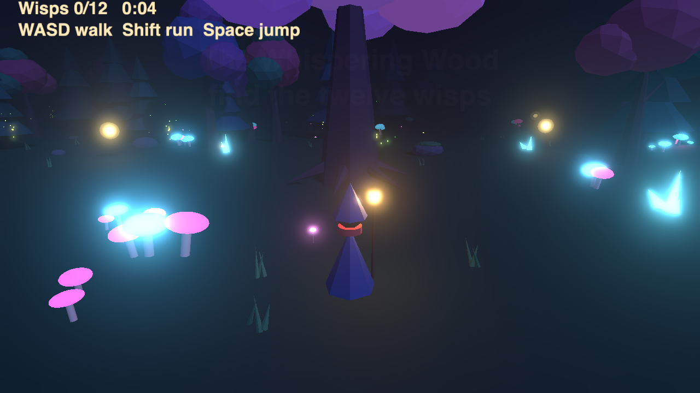

# Tessera

Web 2D/3D game engine designed to be driven by AI agents: games are YAML scenes plus gameplay
code in **Tess** (C++-flavored, compiled to TypeScript) or TypeScript. See [PLAN.md](PLAN.md)
the language spec in [docs/tess-spec.md](docs/tess-spec.md) and the scene format in
[docs/scenes.md](docs/scenes.md). Agent instructions: [AGENTS.md](AGENTS.md).

**[Play the demo: The Whispering Wood](https://beaumont-maxence.github.io/tessera/)**: walk a
night forest with a lantern and gather twelve wisps (WASD, Shift, Space). About 300 lines of
YAML and Tess in [examples/forest](examples/forest): seeded procedural forest of low-poly models built from primitives, glowing
materials with bloom and fog, particles, point lights, hierarchy, physics, HUD and a saved best time.

[](https://beaumont-maxence.github.io/tessera/)

```sh
pnpm install
pnpm dev                                    # examples in the browser (YAML edits hot-reload)
pnpm exec tess run examples/platformer/scene.yaml --frames 120 --dump
pnpm exec tess run examples/arena/scene.yaml --frames 120 --screenshot out.png
pnpm exec tess build examples/arena/scene.yaml --out dist
pnpm test                                   # all tests, including TS/Tess parity
pnpm bench --oracle                         # validate the benchmark offline; `pnpm bench` needs ANTHROPIC_API_KEY
```

## MCP server

Lets an agent inspect and drive a running game (open, state, inspect, set, step, input,
screenshot, logs). Preconfigured for Claude Code (`.mcp.json`) and Cursor (`.cursor/mcp.json`);
see AGENTS.md for Codex. The agent picks the game with `open`, or pass a scene path as argument:

```json
{ "mcpServers": { "tessera": { "command": "node", "args": ["packages/mcp/bin/tess-mcp.js"] } } }
```

Add `--headed` to watch the game in a browser window.

## Editor

`packages/vscode-tess` is a VS Code extension with Tess syntax highlighting.
